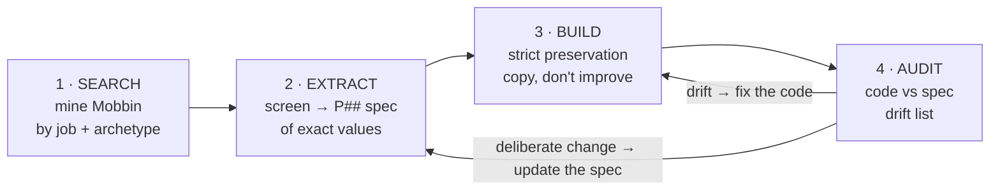

# Mobbin Claude Rodeo 🤠🎯

**Reference guardrails for Claude — find a real UI on [Mobbin](https://mobbin.com), build it *exactly*, and never let the spec go stale.**

---

## What This Does

Claude is great at *finding* strong UI references and bad at *honouring* them. Two failures recur:

1. **Approximation.** You find a sharp sidebar — "compact left rail, 220px, 5 items." Claude builds a Claude-flavoured *impression* of it instead: generic spacing, reordered items, an invented active-state, "helpful" icons. The reference is gone.
2. **Stale specs.** You capture it well, build it faithfully — then the IA changes. The code moves on, the spec doesn't, and now nobody can tell *deliberate change* from *drift*. Every future "does this match the design?" is unanswerable.

**This skill** turns a Mobbin reference into something *load-bearing*: extracted as exact values, built without drift, and kept honest as the product evolves.

---

## How It Works



The loop is the point. A drift sends you back to the **code**; a deliberate product change sends you back to the **spec** — so the reference never silently rots.

| Phase | What happens |
|-------|--------------|
| **1 · Search** | MCP-first (`mcp__mobbin__search_screens` / `search_flows`), manual-screenshot fallback. Query the *job + archetype*, not the aesthetic. Stop at 2–3 convergent precedents. |
| **2 · Extract** | Turn the chosen screen into a numbered `P##` spec block of **exact values** (px, token, item order, presence). Write it into your `DESIGN.md`. Adjectives aren't extraction. |
| **3 · Build** | Copy spec values exactly. No "improvements". Build the boring parts (footers, empty states) — *absence* is the commonest drift. |
| **4 · Audit & Reconcile** | Diff code vs spec into a severity-tagged drift list. Fix real drift — but **update the spec** for deliberate change, same day, with the why. |

---

## The Core Rule

```
The spec is the source of truth. The screenshot was only how you got there.
Copy exact values. Add nothing the reference didn't have. Build the boring parts.
If it's not in the spec, it's a question — not a licence to invent.
```

### ❌ Drift — the LLM mean reasserting itself
```jsx
<aside className="w-56">                    {/* "close enough" → 224px, not 220 */}
  {/* reordered docs-first "for hierarchy"; dropped Chronology */}
  <button className={active ? "border-l-2 border-accent bg-accent/10" : ""}>
    <Icon /> …                                {/* icons the reference never had */}
  </button>
</aside>
```

### ✅ Faithful — values copied, order kept, nothing invented
```jsx
<aside className="w-[220px] shrink-0">
  {/* exactly: assistant · documents · chronology · workflows · audit */}
  <button className={active ? "bg-wash text-ink font-semibold" : "text-muted"}>…</button>
</aside>
```

---

## When To Use

✅ Designing or refactoring an interface from reference apps
✅ "Make this look less generic / less like AI boxes"
✅ "The build doesn't match the design"
✅ Auditing whether a built component honours its reference

❌ Pure-greenfield art-direction with no reference intent
❌ Tweaking copy or logic with no design surface

---

## Install

```bash
git clone https://github.com/b1rdmania/mobbin-claude-rodeo ~/.claude/skills/mobbin-claude-rodeo
```

## Requires

- **Mobbin MCP** — *optional but recommended*. Drives live reference search. Without it, the skill works from pasted screenshots or named reference apps — the rest of the workflow is identical.

---

## Triggers

`find a reference for X` · `how should this screen look` · `use Mobbin` · `design this like [app]` · `build a sidebar/onboarding/settings from real examples` · `make this look less generic` · `the build doesn't match the design` · `audit design fidelity`

## Full guide

[SKILL.md](./SKILL.md) — the four phases in full: search craft, the spec-block format, strict-preservation rules, and the audit + reconcile loop.

## Companion

[`variant-workflow`](https://github.com/ziggythebot/variant-workflow) — strict preservation when converting a *design export* to code. Mobbin Design is the upstream half: sourcing and specifying the reference, then keeping it honest. Neither depends on the other.

---

MIT
