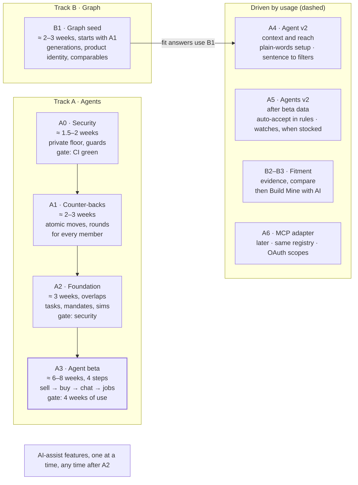

<!--
Repo copy of the Claude Doc "DRVN AI-native: review and implementation plan"
(https://claude.ai/code/artifact/0116734a-9a0d-4148-9efa-ecde4f9a177b), taken at
revision 91 on 17 Oct 2026. The doc is the living plan where Neil rules; this
copy is what build sessions follow, and it is re-taken from the doc whenever a
phase closes or a ruling changes it. Diagrams are redrawn as Mermaid. Build
progress: https://claude.ai/artifact/NnnwYYybSxqHypUcqvrpyd
-->

# DRVN AI-native: review and implementation plan

Oct 14, 2026 · Neil Barrow

## The direction in one page

DRVN stays the car-centred community marketplace it is today. Underneath it, DRVN builds a structured understanding of cars and parts. On top of that, every member gets an agent that buys and sells for them within limits they set. AI isn't a section of the site; it's how the tedious work between "I want X" and "done" gets done.

Your priorities, in the order you set them in the conversation and in this review:

1. **The automotive graph is the most important thing to build.** Nearly every other AI capability depends on it: vehicles, the member's actual car, what's installed, what a part *is*, what fits what, and how we know. Postgres, not a graph database.
2. **The agent layer is next, and it's what pulls people in.** There is one agent per member. The **Garage agent and the Buyer agent are the same agent**: it knows your car and buys for it. The **Seller agent** sells for you. Build and scope both sides together, not one after the other.
3. **The first job for the agents is offers.** Lowballers and haggling are the most obvious pain in car-part reselling. The seller's agent negotiates between your minimum and your asking price. The buyer's agent negotiates up to your maximum.
4. **AI assistance is table stakes, added one feature at a time.** Photo-to-listing, AI build parsing, natural-language search and price suggestions are coming to every marketplace. Each ships when it earns its place. The architecture makes each one cheap to add; it doesn't pre-design or pre-build them.
5. **MCP/API: set it up architecturally if it's practical, don't productise it.** Users come first.

**Rulings from this review (14 Oct)**

- **To the member there is one agent.** "Seller" and "buyer" are internal scopes, not two products.
- **You work with the agent through a chat from launch.** Chat is how people expect to talk to software in 2026. The conversation is about getting things done on DRVN (buying, selling, your Garage), not general chit-chat.
- **Agents never reply to other people.** From A4 they may *read* the messages their owner receives about a listing, for context.
- **The label on agent offers stays, but quiet.**
- **Negotiation follows eBay-style limits that humans and agents share.** Buyers can counter back.
- **The model writes words; rules decide money.**
- **A buyer accepting the seller agent's counter makes a sale.** The seller acknowledges this once per listing. "Cancel before checkout starts" is an exceptional recovery that works only before the buyer starts paying. The seller side doesn't auto-accept offers at launch.
- **The agent accepts a seller counter within the buyer's maximum on its own.** Payment always stays manual.
- **Showing the offer floor publicly is the seller's choice and off by default.** Floors that are public today become hidden when the toggle ships, and the minimum must be unreadable through the database API, not just hidden on the page.
- **Agents gain abilities over time.** Assist features become things the agent does for you, while the manual path stays. Features that need inventory wait for liquidity.
- **The agent must be worth opening for someone who isn't buying or selling right now.** That means Garage jobs at launch.
- **The mobile bottom bar is Explore · Marketplace · Home · Garage · Agent.** Home sits in the centre; the agent is last because not everyone will use it. This reverses PRD N-4 and the bottom-bar non-goal.

## Every AI feature, at a glance

There is one agent, reached from the Agent tab (or the desktop rail) and worked with by chat. Its jobs fall into three groups. **Launch** means the agent beta, **Next** the phase after, and **Later** waits for usage or inventory. Every job also has a manual path that works without the agent.

| Group | Job | What it does | When |
| --- | --- | --- | --- |
| Selling | Handle offers | Counters between your minimum and target in your chosen style; recommends accepting with a reason; a buyer accepting its counter is a sale; cancel before checkout starts is the recovery | Launch |
| Selling | List the parts that came off | Turns removed mods into draft listings with a price guide and fitment from your car; you add condition and photos, then publish | Launch |
| Selling | Listing from photos | Identifies the part from your photos and drafts the listing; you confirm everything it can't know | Launch |
| Selling | Reads your messages for context | Uses the messages you receive about a listing to make its notes smarter; never replies | Next |
| Selling | Auto-accept within your rules | Accepts at or above your accept line without a tap | Later, once beta cancellation rates are low |
| Selling | Price nudges, Q&A drafts | Suggests a price drop with comparables; drafts replies that you send yourself | Later |
| Buying | Negotiate for me | Offers up to your maximum within the 3-offer limit; accepts a seller counter within your max; tells you the gap if rounds run out; you always pay | Launch |
| Buying | Will this fit my car? | Answers from DRVN's fitment evidence and says how it knows (seller-stated, same platform, unknown) | Launch |
| Buying | Find one that fits my car | Watches for a part that fits, then negotiates within your max | Later, when inventory supports it |
| Buying | Build Mine, goal planning | AI-chosen equivalents and plans from your Garage | Later (B3) |
| Garage | Update my build | "Just fitted KW V3s", a product link or a photo becomes a mod row; the replaced part is marked removed, and it offers to list the old one | Launch |
| Garage | Post an update | Photos from today plus a sentence become a draft car update with the parts tagged; you publish | Launch |
| Garage | Paste your build | A pasted build list becomes structured mod rows | Launch |
| Garage | Compare with my car | Lines up another car's mods with yours, plus parts for sale that fit yours | B2 (also a no-AI button on car pages) |
| Anywhere | Ask about DRVN | Questions answerable from public data the tools already reach, such as "how many Monte Carlos are for sale?"; never other members' private data | Next, as a side effect of the search tools |

The same capabilities power manual buttons: the price guide on the sell form, "Paste your build" in the mods editor, sentence-to-filters in Marketplace search.

Not planned now: admin and analytics agents, automatic payment, agents messaging people, dynamic bundles, open-ended chit-chat.

## My opinion

The direction is right, and offers are the right first job for the agents. They work at any marketplace size, the pain is obvious, and DRVN's offer code is already strict and retry-safe. My first draft put AI-assist features first and agents at Phase 4. That reversed what you'd decided in the conversation, and this revision corrects it.

**What I got wrong in the first draft**

- I treated two assist features as the first release. You'd already said assist features are progressive extras, not the foundation.
- I called the agent runtime "plumbing judged by nobody". With offers as its first job, it has a real user from day one.
- The migration report makes the same mistake: it puts agent offers in its Phase 8, after listing drafts, watches, build intelligence and admin agents.

**What I'd still hold firm on**

- **Offers need a real upgrade first.** Today a buyer can't counter a counter, so the new negotiation rules (eBay-style) are the first build, before any agent.
- **Agents get the same round limits as humans.** Unlimited agent-to-agent rounds add no information, and they let a buyer agent find a hidden floor by trial and error. A shared limit protects sellers, keeps the history readable, and is fair to anyone not using an agent.
- **A counter is a commitment.** If the buyer accepts the agent's counter, the part is sold, exactly as with a human counter. "No auto-accept at launch" doesn't make the agent harmless. The limits the seller sets are what make it safe.
- **The v1 offer agent barely needs a language model, and that's good.** Prices come from rules, and explanations can be templates. The agent architecture that matters is the owner's limits, a worker that reacts to offer events, policy checks, approvals and an audit trail. The model plugs in later for setup in plain words, owner chat and the buyer agent's research.
- **The graph runs as its own track from the start.** The buyer agent's next jobs ("find one that fits my car") need generations and product identity, so the graph can't wait behind the agents.

**What I'd still defer from the conversation**

- An AI-generated, personalised Home. The PRD rules out a personalised Home this cycle.
- Dynamic bundles and outcome planning until the graph has evidence.
- Full vehicle variants. Platform codes (Mk8, G20, 8Y) do most of the work.

## Plan check against the code

The migration report is largely accurate about DRVN 2. It describes `main` at `24b8727` correctly. Its big claims hold: mature commerce, a disciplined AI importer, leased workers, MFA-gated admin, typed analytics, URL-driven search state. It gets a few schema details wrong and misses one asset that matters a lot: DRVN already has a part-number identity layer.

| Claim in the report | Verdict | What the code says |
| --- | --- | --- |
| Importer is schema-forced, injection-aware, validated, stubbed for tests | Confirmed | Forced `tool_choice`, temperature 0, `<source_post>` wrapping, "never invent" rules, post-validation drops values not in the source (`extract/ai.ts:129–194`, `validate.ts:93`) |
| It's the only LLM call in the app | Confirmed | Only `listing-import` uses `@anthropic-ai/sdk`; add-mod-by-link deliberately uses no AI (`mods/part-link.ts:23`) |
| Durable import state machine with leases | Confirmed | `listing_imports`: pending → fetching → extracting → importing\_media → ready, 3-minute lease, CAS transitions (`engine.ts:354`, `0047`) |
| Idempotent listing create, stale-checked edit | Confirmed | `claim_listing_creation` with request id + payload hash; `save_listing_edit` with `expected_updated_at`, uncertain-outcome reconcile (`sell/actions.ts:247–562`) |
| Admin capability registry: family → role | Partly | Exists, but all 11 families require `admin`; real enforcement is `assert_admin_actor` in SQL. `admin.mfa_recovery` writes audit rows from a family the registry doesn't list (`admin/capabilities.ts:24`) |
| Append-only `admin_audit_log` with metadata | Confirmed | Update/delete blocked for every role; `subject_type` limited to six values; `metadata jsonb` is where agent provenance fits (`0018_admin.sql:109–150`) |
| Admin MFA AAL2 + fresh authenticator | Confirmed | App guard (`admin/guard.ts:46`) and SQL `is_admin()` + 900 s TOTP step-up in `execute_admin_command` |
| `remediation_jobs` is a fixed-kind leased queue | Confirmed | CHECK list of six kinds, `FOR UPDATE SKIP LOCKED`, 2-minute lease, 10 attempts; reuse the pattern, not the table, as the report says |
| Analytics: typed, consented, no autocapture, PostHog optional | Confirmed | 27-event union, consent cookie + row, server-side via `after()`, purchase via outbox (`analytics.ts:29–88`) |
| `cars` has catalog ids, VIN decode, normalised keys | Confirmed | `catalog_make_id/model_id`, `make_key/model_key`, vPIC decode; VIN is owner-only via `my_car_vin()` |
| Catalog can host generations | Partly | `catalog_makes/models` are make + model only: no years, generations or trims. Nothing like `platform_code` exists anywhere |
| `mod_items` has alternate part numbers | Wrong | One `part_number` only. Status is `installed`/`removed`; links to `linked_listing_id` and unique `source_order_item_id` |
| Listings link back to their source mod | Wrong | No: the link runs one way, `mod_items.linked_listing_id` |
| No canonical product identity exists | Partly | No `products` table, but the report misses `listing_part_numbers` and the internal `part_number_links` graph (alternate, supersedes, interchange, aftermarket\_equivalent, same\_product) in `0042_part_identifiers.sql`. That's the seed of product identity |
| Seller fitment is structured | Partly | Structured make/model/year range, but free text with no catalog ids (`0025_fitment.sql:74`) |
| `listing_vehicle_fit` is a projection with `via` | Confirmed | `via` is `stated` or `car`, trigger-maintained, keyed on lower-cased strings (`20261011100000`) |
| Fitment evidence language exists | Confirmed | `seller_stated / source_model / year_needed / outside_years / unknown` (`marketplace/fitment.ts:71`) with an SQL twin |
| Purchase snapshot immutable; purchase → mod | Confirmed | Immutable except zeroing shipping on a collection order; `addPurchaseToCar` works but drops the brand (`add-to-car-actions.ts:33`) |
| `saved_searches` with alerts is a watcher primitive | Confirmed | 30-minute worker re-runs the marketplace query since last check and sends the `saved_search` notification |
| Search provider abstraction, Postgres + Typesense | Confirmed | Both for marketplace and explore, with a queue, batch claiming and rebuild scripts |
| pgvector not enabled | Confirmed | None; extensions are `pg_trgm`, `pg_cron`, `pg_net` |
| Definer exposure guard exists; search-path guard missing | Confirmed | Anon allowlist (18) plus 5 named internals for authenticated; no general search-path guard, as the report says |
| A shared runtime schema library would help | Confirmed | None today; every action parses `FormData` by hand, the database is the real check |
| "Wrap existing server actions as capabilities" | Partly | 33 `use server` files, about 140 exports, about 120 RPCs called inline. No service layer exists, so wrapping means splitting each action into a typed core plus a form adapter |
| Supabase Advisor counts (26 / 10 / 45 / 65 / 79 / 39 / 60 / 45) | Not checked | Confirmed live by the second review (15 Oct): 10 mutable search paths, 45 anon and 65 authenticated definer functions, 79 init-plan, 39 unindexed foreign keys, 60 permissive-policy warnings, leaked-password protection off |

The report's "current product" claims (two doors, fixed Home, no bottom bar, car is context) match the PRD exactly. Its Appendix E is right that nothing in the architecture forces a PRD conflict.

**Offer code today, which the agents build on**

| Fact | Where | What it means for agents |
| --- | --- | --- |
| One round only: open → countered → accepted/declined; buyers can't counter back | `domain/states.ts:58`, `offer-actions.ts:132–353` | Negotiation rules must change before any agent |
| Offers expire after 72 hours | `offer-actions.ts` expiry check | Agent turns are instant, but human turns keep a clock |
| Offers below the floor are refused, with the number shown: "doesn't consider offers below $X" | `offer-actions.ts:89`, SQL twin in `20260913134823` | A hidden floor needs a message without the number |
| The floor is shown on every listing that has one: "Offers accepted from $X" | `listings/[id]/page.tsx`, `purchase-actions.tsx:274` | Becomes a seller toggle, off by default. The column is also readable through the API today, so it must be locked down too (P0, second review) |
| Accepting creates an order; the buyer has 24 hours to pay | `offer-actions.ts` accept path | Payment stays manual, which satisfies "no auto-payments" |
| Sellers can already cancel a pending (unpaid) order | `seller_cancellation_guard.sql` | Cancellation exists, but only until the buyer starts checkout; see the second review |
| Offer actions read and check with the service-role client | `offer-actions.ts:137` | The agent's offer actions must run as database functions that take the acting member and the mandate, not as copies of this code |
| 10 offers per 10 minutes per user | `rate-limit.ts:28` | Agents need their own limit; they count against the owner's |

## Corrections and better ways

Eleven changes to the report's plan. The first four change the data model, the next four shape the agent runtime, and the last three fill gaps. Items 6 and 8 were revised on 14 Oct for the offer-agent direction.

**Data model**

1. **Grow products out of the part-number graph that already exists.**
   - `listing_part_numbers` and the internal `part_number_links` (alternate, supersedes, interchange, aftermarket\_equivalent, same\_product) already link part numbers.
   - A product needs explicit, brand-aware membership: only same-product or verified identity merges records, and interchange, supersedes and aftermarket links stay edges (corrected in the second review). Add `products` with that membership table. Extend `part_number_links` with `confidence` and provenance rather than creating a parallel `product_identifiers` table.
   - Add a generated `part_number_compact` and `brand_key` to `mod_items`. Mods and listings then join on part number right away, so "a part from your build is for sale" and price comparables work before any product exists.
2. **Vehicles: generations only, resolved deterministically.**
   - Add `vehicle_generations` (catalog model, platform code, year range) under `catalog_models`.
   - Most cars resolve from `catalog_model_id` + `year` alone. Ask the owner only when years overlap, such as a facelift year.
   - Add nullable `catalog_model_id` and `generation_id` to `listing_fitments`, and keep the text.
   - Skip `vehicle_variants` until a real fitment rule needs engine or transmission.
3. **Don't duplicate seller fitment into a new evidence table.**
   - `listing_fitments` already holds the seller's claims, and `listing_vehicle_fit` already projects them with `via`.
   - Add `product_fitments` only for product-level claims (manufacturer, community, DRVN inference, admin).
   - "Installed on 17 Mk8s" (recorded by members, not verified) is a query over `mod_items` by product and generation, so make it a view or aggregate, not stored claims.
4. **Fix the data leaks that starve the graph.**
   - `addPurchaseToCar` drops the brand; copy it from the snapshot.
   - The mods paste parser is regex-only; make it the first AI upgrade.
   - Selling from a mod should write the mod's part number into the listing so the link runs both ways.

**Runtime scope**

5. **Capabilities mean splitting actions, not wrapping them.**
   - Each server action today parses `FormData`, calls RPCs and redirects.
   - Pull out a typed core, `run(ctx, input)`, and leave the action as a thin form adapter. Do this one capability at a time, starting with the offer actions.
   - Add zod 4: one schema gives runtime validation, the model's tool definition, and later the MCP schema. The installed SDK (0.122) ships zod and JSON-schema tool helpers.
6. **Two contexts: the member present, and the agent acting while they're away.**
   - When the member is present (the UI or their own agent chat), `ctx` carries their own database session, so the database's per-row access rules apply.
   - When the agent acts while the owner is offline, there is no member session. Those actions go through database functions that take the acting member and the mandate id, check that the mandate allows this exact action and amount, and record `made_by = 'agent'`. The database enforces it, not the worker.
   - Service-role reads in helpers such as `recommendations.ts` stay out of agent tools unless declared and tested.
7. **Use the SDK's tool runner where a model is involved; keep offers deterministic.**
   - The installed SDK has `BetaToolRunner`, used for owner chat and buyer research, with a policy check inside each tool.
   - Offer decisions are a pure function of the mandate and the offer thread. They're testable without a model and impossible to talk out of the seller's floor.
   - Extract a thin `src/lib/ai/` from the importer. Don't design for multiple providers yet.
8. **Build the runtime pieces the offer agent needs, and no more.**
   - Now: `agent_mandates` (the owner's limits), `agent_actions` (the append-only "why" log the owner sees), `agent_approvals`, a leased `agent_jobs` queue fed by offer events, and the private run log.
   - Two principals: `member` (with seller and buyer as scopes) and `admin_assistant` later.
   - `agent_memory`, the `/agent` hub and analytics or admin agents wait until a second job exists.

**Gaps the plan doesn't cover**

9. **"Compare with my car" can ship early, without AI.**
   - Lining up two cars' mod lists by category, brand and part number is honest without any fitment claim: "They run KW V3, you run APR Roll-Control."
   - Only the "for sale for your car" line needs evidence, and `listing_vehicle_fit` already provides it.
   - Build Mine with AI equivalents comes later. The plan holds the whole feature back for product identity; most of it doesn't need it.
10. **Model choice and cost need numbers.**
    - The importer defaults to `claude-sonnet-5`; review that against the current 5.5 models.
    - Use a cheaper model for classification and the stronger one for planning and extraction.
    - Cache shared prompt prefixes. Record tokens and cost per run from day one.
11. **Evals should be concrete fixtures, not a promise.**
    - Keep a `tests/agent-evals/` folder of anonymised real listings, posts and build lists with expected outputs.
    - Run recorded responses in normal `npm test`, and run live evals only on demand.
    - Copy the importer's stub so tests never hit the network.

## Target architecture

The layers match the report's, with two changes. The AI client is a shared service, not a layer. The UI calls capabilities directly, without going through the agent.

```mermaid
flowchart TB
  exp["<b>Experience</b> — existing surfaces<br/>Offer threads (agent-marked) · Handle offers for me · Negotiate for me<br/>Agent tab in the mobile bottom bar · notifications with why · settings"]
  run["<b>Agent runtime</b> — A2<br/>agent_tasks · mandates · events · leased worker · approvals<br/>narrow worker role · conversations kept separate · tool runner"]
  cap["<b>Capabilities</b> — A2<br/>src/lib/capabilities: zod in/out, risk R0–R4, member's RLS client<br/>Offline agents act via DB functions that take member + mandate"]
  graph["<b>Automotive graph</b> — Track B, runs alongside<br/>cars → vehicle_generations (new) · mod_items + part keys · products (new)<br/>part_number_links, listing_part_numbers (exist) · listing/product_fitments<br/>listing_vehicle_fit stays derived · outcomes are views over mod_items"]
  rec["<b>Systems of record</b> — exist today<br/>Postgres + RLS · Stripe state machines · leased workers · search · audit<br/>Authority stays here: approvals re-check live state before any write"]
  ai["<b>AI client</b> · A2<br/>src/lib/ai · models · usage log<br/>untrusted wrapper · test stub (from the importer)"]
  mcp["<b>MCP adapter</b> · A6<br/>outside agents · same registry · OAuth scopes"]
  exp --> run --> cap --> graph --> rec
  exp -- "UI calls capabilities directly too" --> cap
  run --> ai
  cap --> ai
  mcp -.-> cap
  style graph stroke-width:2px
  style mcp stroke-dasharray: 4 4
```

Everything in the graph box except `vehicle_generations`, `products` and `product_fitments` exists today. The dashed MCP adapter is drawn so its seam is reserved; it isn't built until A6.

## Implementation plan

Two tracks run side by side. **Track A** builds the agent: security and contracts first, then negotiation rules everyone can use, then the agent foundation, then a beta in four gated steps. **Track B** builds the graph. Reaching the end of A3 is a planning hypothesis of about 14–17 weeks solo, not a commitment. Each A3 step ships on its own, so members see value well before the end. Revised 15 Oct after the second review. Every phase's gate also includes the documentation and component updates listed in the next section; a phase isn't done until the docs and the component library match the code.



To the end of A3: about 14–17 weeks as an estimate, not a commitment. Work under "Driven by usage" waits for usage.

Dashed bands start when usage justifies them. B1 starts alongside A1.

### A0 — Security and contracts (≈ 1.5–2 weeks)

- **P0: make the minimum private, as its own rollout with its own gate.** It runs in three steps, so neither an older app version nor a half-finished migration breaks anything or exposes more than today.
  1. **Expand.** Create the owner-only `listing_private_terms` table. The sell and edit actions and their database functions (`claim_listing_creation`, `save_listing_edit`) write the minimum to both places. Backfill existing listings.
  2. **Switch.** Offer validation (the app check and the SQL submission functions), the sell form and the edit page read the minimum from `listing_private_terms`, the sellers through an owner-only function. Regenerate the database types. Update `account-export-contract.ts` and the deletion worker. Confirm no search projection carries it (none does today).
  3. **Contract.** Only after the new app version is live everywhere: null and drop `listings.offer_floor_cents`.
  - `listings` keeps only public display values, such as a minimum the seller chose to show. Moving the column out matters because `listings` has table-wide SELECT, which overrides a column revoke. It also keeps the listing page's `select("*")` working.
  - The refusal message becomes generic.
  - **Gate:** a new `offer_floor_privacy_guard.sql` (anonymous, other-member and every-RPC reads), the listing create, edit and offer regression suites, and `db:types:check`.
- **Advisor follow-up.**
  - Pin the 10 mutable search paths and add `function_search_path_guard.sql`.
  - Give `definer_exposure_guard.sql` an authenticated allowlist and review the 65 authenticated definer functions for what they return.
  - Fix RLS init-plan warnings on commerce and agent hot paths.
  - Turn on leaked-password protection.
- **Docs and contracts.**
  - The PRD amendment is done (17 Oct: §4.9 Intelligence, M-8 narrowed, N-4 reversed). Next, the CLAUDE.md pointer, product-overview and the repo copy of this plan.
  - An ADR fixing the agent context shape (principal + scope + permissions), the capability interface, the lock order, the floor precedence rule and the binding-snapshot rule.
  - Update the registry scope line, and add `admin.` to `admin/capabilities.ts`.
- **Data rules.** Retention, deletion, export and redaction for conversations, tasks and events. What may be sent to the model provider, and what never is (addresses, payment details, VINs).
- **Ops.**
  - Restore CI. It's a launch blocker for anything touching money.
  - Write the privacy and terms wording.
- **Gate:** floor rollout complete and guarded; CI green; PRD approved.

### A1 — Negotiation v2, for everyone (≈ 2–3 weeks)

Ships to all members, agent or not: buyers can counter back.

- **Rules (eBay's model):** up to 3 buyer offers per listing, counted across every thread the buyer opens on it; strict turns; seller counters at or below asking; each turn replaces the last; 72-hour expiry per turn.
- **Failed probes cost a turn.**
  - Today a below-minimum offer is refused before any record exists (`offer-actions.ts:87`), so failed attempts are free.
  - In v2, a below-minimum submission is recorded as an immediately declined round and uses one of the buyer's 3 offers. The number is never revealed.
  - Patterns across related accounts feed `abuse-identity.ts`. Without this, the 3-offer limit doesn't protect the floor.
- **Every issued round snapshots its binding terms:** amount, expiry, acting principal (the member, or the agent's task and job), mandate version and the limits in force.
  - New proposals must respect current limits.
  - Accepting an outstanding, unexpired round honours its own snapshot. So raising the minimum, changing the price or turning the agent off later can't break an offer already made.
- **One lock order for every path:** listing → negotiation → order → payment.
  - First write down the order the current checkout, acceptance and cancellation functions actually use. Today `offer_accept_begin` locks the offer before the listing.
  - Then make every path follow the one order.
- **One transition function for every move,** human or agent: `offer_move(offer, kind, amount, idempotency_key, expected_round)`.
  - The acting member comes from the session, or for agents from a leased job (see A2). It is never a request argument.
  - In one transaction it takes the locks in order and checks the actor's role, beta access, suspension, turn, limits (effective floor, ≤ asking) and expiry.
  - It applies a fail-closed rate limit, appends to `offer_rounds` with the snapshot, and updates the current state.
  - On acceptance it runs the existing reserve-and-order logic, which `offer_move` now owns.
  - In the same transaction it writes notification and agent jobs (a transactional outbox).
- **Retries are safe.** A repeated idempotency key replays the result. A stale `expected_round` is refused.
- **Cancel before checkout begins**, enforced in the database. `settle_seller_cancellation` also refuses once `accepted_checkout_shipping` is frozen, not only once payment starts.
- **Code.** Split cores out of `offer-actions.ts`; offer history view in `OfferCard`; the "Show my minimum" toggle in `SellForm`.
- **Gate:**
  - Guards for turns, limits across threads, below-minimum attempts consuming a turn, snapshot honoured after a limit change, replay, stale rounds and the checkout-frozen cancellation refusal.
  - Concurrency tests: buyer accepts vs seller cancels, two counters at once, acceptance vs another buyer's checkout.
  - An e2e three-round negotiation.
  - The existing checkout, notification and order-recovery suites still green.

### A2 — Agent foundation (≈ 3 weeks, overlaps the end of A1)

Ships nothing visible to members. It proves the agent with simulations first.

- **Agent context:** principal + scope + permissions. Members now; a future Admin or Analytics agent shares the same runtime with different scopes.
- **Typed domain services** in `src/lib/capabilities/`. The agent never calls React Server Actions. Plus composable reads the model can combine: search, car, product, fitment evidence, comparables.
- **Separate data for separate things:**
  - `agent_mandates`: limits, version, expiry, status. A mandate may set an agent minimum stricter than the seller's floor, never lower; the effective floor is the higher one.
  - `agent_tasks`: what it's trying to achieve, with statuses working, waiting\_for\_event, needs\_approval, completed, failed, cancelled.
  - `agent_events`: append-only record of what happened. Each entry holds the decision or tool call, the mandate version, the initiating event, inputs, result and idempotency key.
  - `agent_conversations` and messages: chat only.
  - `agent_approvals`, and `agent_jobs`: the outbox queue, separate from tasks, so an expired lease never loses a member's objective.
  - All of these join the account export contract and the deletion worker.
- **The worker's real identity.**
  - A dedicated Postgres login role, `agent_worker`, connecting through the pooler with its own credential, never `createAdminClient()`.
  - Its only permission is executing the `agent_*` functions.
  - Every agent\_\* write must present a job and lease. The function checks that the job is claimed, the lease is still valid, and the job's task and expected action match this exact call. Only then does it load the owner from the task and mandate and re-check role, ownership, amount, state and revocation. A valid mandate ID alone does nothing, so a buggy or compromised worker can't reuse mandates for unrelated actions. Supabase supports custom login roles through its pooler, so this is feasible.
- **Kill switches in admin:**
  - Pause all agent negotiation, or only the buyer or seller side.
  - Disable one agent or one mandate.
  - Stop one listing or account.
  - Existing offers and orders stay intact, with a written reconciliation runbook.
- **Injection defences on every tool,** copying the importer: outside content is wrapped as untrusted data, tools are allow-listed per scope, structured output is validated, and retrieved text is never treated as permission.
- **`negotiate.ts`**: a pure function with property tests.
- **Deterministic simulations** before any member sees it: seller agent vs a person, buyer agent vs a person, agent vs agent.
- **`src/lib/ai/`** and `run.ts` around the SDK tool runner, plus the `tests/agent-evals/` fixture suite. They're built here, and first used by members in A3c.
- **Monitoring:**
  - Watch for stuck tasks, stale jobs, repeated decisions, permission denials and model errors, plus a sweep that reconciles missed outbox events.
  - Send these to operational telemetry, separate from consent-based product analytics.
- **Gate:**
  - A security regression set: reading hidden floors, calling privileged RPCs directly, reading another member's mandate, duplicated event delivery, acting after the owner disables it, and acting while a kill switch is on.
  - All simulations pass.

### A3 — Agent beta in four gated steps (≈ 6–8 weeks total)

Ships behind `AGENTS_BETA`. Each step opens only when the previous gate passes.

1. **A3a Seller negotiation (no chat yet).**
   - "Let DRVN handle offers", with the seller acknowledging once that the agent's counters are binding.
   - The Agent tab with Needs you · Working · Done, settings and task deep links.
   - The bottom bar, after a prototype at 360–390px.
   - Gate: no floor leaks, counters behave, cancellations stay rare.
2. **A3b Buyer negotiation.**
   - "Negotiate for me" with an item-price or item + shipping ceiling.
   - Only on listings where the total is knowable before checkout.
3. **A3c Chat arrives.**
   - The language model is used here for the first time, through the A2 tool runner.
   - Chat for setting up and checking negotiations, "Update my build" from words or a link, and "Will this fit my car?".
   - Gate: people with no active deal come back to the Agent tab.
4. **A3d More jobs, one at a time, photo understanding included.** Post an update → list the parts that came off → paste your build → listing from photos.

There's no invited cohort (decided 17 Oct). Each step turns on for everyone behind the `AGENTS_BETA` flag once the previous gate passes.

### Alongside A3c–A3d — two seller helpers (no AI)

Added 17 Oct. Both features work without the agent, neither depends on A0 or A1, and the agent reuses both in AG-9. The wording of both lists is drafted as a document for Neil to sign off before any code.

- **Photo shot lists on the sell form.**
    - 3–5 short suggested shots for each marketplace subcategory (about 30 in `taxonomy.ts`), for example coilovers: full set side by side · threads and collars · top mounts · part number label.
    - A generic list (whole part · labels and part numbers · any damage) shows until a category is known. Photos is step 1 and category step 2; a mod line or an import often prefills the category.
    - Finer splits only where one subcategory hides very different parts, such as "Coilovers & Springs" or "Sway Bars & Arms".
    - A suggestion, never proof of condition and never required: publishing still needs one photo (M-5, W-2).
    - A static map in `src/lib/marketplace/photo-guide.ts`, with no migration and no AI. Later, "listing from photos" (AG-9) uses the same map to suggest missing shots.
- **"What came off" for stock parts.**
    - The build sheet lists only aftermarket mods, so fitting first coilovers to a stock car leaves nothing to mark as removed, and the stock parts never get listed.
    - When a mod is added or replaced, offer the stock parts it usually replaces as tick boxes (stock struts ×4 · stock springs ×4 · top mounts). It asks once per mod, can be dismissed, and offers a few items at most.
    - Ticked parts become removed lines marked stock, each with List it, so the listing carries the source car's fitment, with the car maker as brand.
    - This needs finer mod types than `ModCategory`: a keyword match on the product name, with a short pick list as a fallback. It overlaps B1.
    - The plain button ships first (AG-11); AG-9 "update my build" calls the same function.
- **Ruled out (Neil, 17 Oct):**
    - a longer condition checklist;
    - photos as condition evidence;
    - a "known issues" section;
    - "also fitted", "often fitted with" and "before you buy" notes;
    - a learned "fitted together" table;
    - any runtime retrieval over outside reference material.

### B1 — Graph foundation (Track B, ≈ 2–3 weeks, starts with A1)

- `vehicle_generations` and `cars.generation_id`, resolved from model + year.
- **Products with correct identity:**
  - A brand-aware membership table links products to identifiers.
  - Only `same_product` or verified identity merges records into one product.
  - Interchange, supersedes, alternate and aftermarket equivalents stay as edges in `part_number_links`.
  - The backfill sends anything ambiguous to an admin list.
- `mod_items` part keys. `addPurchaseToCar` keeps the brand.
- `product_fitments` from day one, recording source, relationship type, date, verification status and configuration constraints (engine, gearbox, brakes). A full variant catalog can still wait.
- Price comparables (paid-and-completed sales only, net of refunds, with condition, shipping and age, and a minimum sample) from listings and `commercial_snapshot`.
- **Gate:** product coverage measured; `listing_vehicle_fit` output unchanged; 2M-scale query plans rechecked.

### B2 — Fitment evidence and "Compare with my car"

- Fill the B1 `product_fitments` table from richer sources (manufacturer data, admin review, confirmed installs), and add catalog ids on `listing_fitments`.
- "Installed on N cars" views.
- "Compare with my car" on `/cars/[slug]` (no AI).

### A4 — Agent v2: context and reach

- The agent reads the messages its owner receives about each listing, to make notes and advice smarter. It never replies.
- Ask about DRVN: questions answerable from public data through the search tools ("how many Monte Carlos are for sale?").
- Sentence to filters on the Marketplace, as removable chips.
- "Will this fit?" gets richer as B1 and B2 land.
- Extend the A2 task system to long-running jobs such as watches.

### A5 — Agents v2 (driven by usage and inventory)

- Seller auto-accept within rules, once the beta shows a low cancellation rate.
- Price-drop proposals and stale-listing nudges.
- Draft Q&A replies that the owner sends.
- Buyer "find one that fits my car" watches, only once inventory makes them useful. The agent dashboard (see UX).

### B3 — Build intelligence

Build Mine with AI equivalents, goal planning, and pgvector if similar-build search needs it.

### A6 — Outside agents

An MCP/API adapter over the same registry, with OAuth scopes and revocation. A graph database only if measured query plans call for it.

### Any time after A2 — AI-assist features, one at a time

"List it with DRVN", "Paste your build", natural-language search, photo-to-listing. Each is a capability plus UI, with no new architecture. The "List it with DRVN" spec from the first draft stays in the appendix for when it's picked up.

## Documentation and the component library stay in sync

Each phase updates every document and component it touches, and that's part of its gate (added 17 Oct). The repo's tests already enforce part of this: registry ↔ exports, registry ↔ docs, the recipe and spacing ratchets, generated-docs sync and database types. The rest is a checklist the gate checks.

**Product and engineering docs**

| Document | What changes | Phase |
| --- | --- | --- |
| `docs/DRVN-PRD-2026-09.md` | §4.9 Intelligence, principle 5, N-4 reversed, M-8 narrowed, data changes, measures, parked rows. **Done 17 Oct**; kept in step with every later ruling | Every phase |
| `CHANGELOG.md` | Entry for the PRD amendment (**done 17 Oct**), then one per shipped step | Every phase |
| `docs/plans/` | A repo copy of this plan so build sessions follow it, updated as phases close | A0 |
| `CLAUDE.md` (Product direction) | Point to PRD §4.9 and the plan; note the bottom-bar reversal | A0 |
| `docs/product-overview.md` | The narrative "what and why" gains the agent | A0 |
| `implementation-registry.ts` + `npm run docs:implementation` | Drop "AI authoring/enrichment" from out-of-scope; add agent and negotiation entries | A0, then each phase |
| Privacy and terms pages | What the agent does and what reaches the model provider | A0, before A3c |
| `docs/site/domain-states.md` + `src/lib/domain/states.ts` | Offer rounds, cancel before checkout, agent task states | A1, A2 |
| `docs/site/notifications.md` + `notifications/kinds.ts` | New offer-round and agent kinds | A1, A3 |
| `docs/site/operations.md` + production runbook | Agent worker role, kill switches, outbox sweep, reconciliation runbook, agent monitoring | A2 |
| `docs/site/listing-import.md` | The importer moves onto the shared AI client | A2 |
| `docs/site/vehicles.md` (+ `search.md` if search documents change) | Generations, product identity, fitment evidence | B1, B2 |
| `supabase/MIGRATIONS.md` | Every migration as applied | Every phase |
| Generated docs (`docs:components`, `docs:systems`, `docs:implementation`) | Regenerated whenever their sources change | Every phase |
| Readiness report artifact | Updated at each merge milestone, as today | Every merge |

**Design documentation**

| Document | What changes | Phase |
| --- | --- | --- |
| Figma file | Bottom bar, agent screen (mobile and desktop), side panel, offer history with rounds and the "via agent" label, the limits form, the confirm card, Night variants. **Designed before A3a is built**, then kept in step | A2 → A3 |
| `docs/site/patterns.md` | Agent patterns: result card, confirm card, Needs you · Working · Done, contextual entry, offer history | A1, A3a, A3c |
| `docs/site/rules.md` | Agent rules: speaks only to its owner, the quiet label, no chat bubble, every task works without it | A3a |
| `docs/site/components.md` §12 | Where `BottomNav`, `SidePanel` and agent cards sit in the taxonomy | A3a, A3c |
| `docs/site/design-system.md`, `motion.md` | Bottom bar and panel layout, safe areas, open and close motion | A3a, A3c |

**Component library**

The CLAUDE.md workflow applies to every item:

1. Look in the registry first and compose.
2. A new component gets a registry entry, a barrel export, `npm run docs:components`, a specimen on the components page, a Storybook story, a CSS recipe in its family file, and a Figma component.
3. No phase closes with a component used in code but missing from any of those.

| Component | New or changed | Phase |
| --- | --- | --- |
| `BottomNav` (ui primitive) | New | Prototype A2, ships A3a |
| `SidePanel` (ui primitive, non-modal) | New | A3c |
| `AppShell`, `LivesheetBar` | Changed: mount the bar and the panel; mobile top bar gains avatar and Messages | A3a |
| `OfferCard`, `OfferDecision`, `DealCard` | Changed: round history, buyer counter-back, snapshot terms, "via agent", binding acknowledgement | A1, A3a |
| `SellForm` | Changed: "Show my minimum" (A1), "Let DRVN handle offers" (A3a) | A1, A3a |
| `ListingQuickCommerce` / offer box | Changed: "Negotiate for me" | A3b |
| `StatusChip` | Changed: agent task states | A3a |
| Agent home segments | Composed from `SheetTabs` or `TabNav`; no new component | A3a |
| Agent thread | Composed from `MessageThread`, `ThreadEvent`, `ThreadDivider`, `ChatComposer` | A3c |
| `AgentResultCard` (commerce pattern) | New only if used in two or more places; otherwise a composed `ObjectRow` | A3c |
| Confirm card | Composed from `ObjectRow` and `ConfirmDialog` | A3c |
| "via agent" label | A CSS recipe, not a component | A1 |

## First release: the agent (A3)

Both sides get an agent that negotiates inside limits the owner sets, on the new eBay-style offer thread. Plain code decides every price. The agent talks only to its owner; the other side sees normal offers marked as agent-sent.

**Negotiation rules (A1, for everyone, humans and agents alike)**

| Rule | Value | Where it comes from |
| --- | --- | --- |
| Buyer offers per listing | 3, counter-backs included; declining doesn't use one | eBay, most categories |
| Turns | Strictly alternating; no second counter while one is waiting | eBay |
| Seller counter | At or below the asking price; at or above the minimum if one is set | eBay plus DRVN's floor |
| Each new turn | Replaces the last one | eBay |
| Expiry | 72 hours per turn, as today; consider 48 | DRVN today |
| Agents | Same rules, but they take their turn instantly | This plan |

**Seller agent: "Let DRVN handle offers"**

Set on the sell form or the listing's manage page:

- **Minimum:** the walk-away price, using the existing `offer_floor_cents`. A separate "Show my minimum on the listing" toggle is off by default.
- **Target:** what the agent aims for. Defaults to the asking price.
- **Style:** Firm, Balanced or Flexible, which sets how fast it gives ground each round.

What it does:

- **Turning it on:** the seller confirms once per listing that the agent's counters are binding offers to sell, within the limits shown.
- **Below the minimum:** the system refuses the offer with a generic message. The number is never shown unless the seller chose to show it.
- **Between minimum and target:** it counters, giving ground according to the style. It never goes below the minimum or above the asking price.
- **At or above target, or the buyer's last allowed offer at or above the minimum:** it recommends accepting. The seller gets a notification explaining why and taps Accept or Counter. Nothing is auto-accepted at launch.
- **When the buyer accepts the agent's counter:** the part is sold and an order is created (24 hours to pay). The seller is notified with the reason.
- **Cancel before checkout starts:** this is a recovery option, not a routine undo. It shows only while cancellation can actually succeed: before the buyer starts paying, and never while the payment state is uncertain (the existing `settle_seller_cancellation` rules). No mark against the seller during beta.

Worked example with your numbers. Listed at $250, minimum $230, target $245, Balanced:

1. The buyer offers $232 (offer 1 of 3). The agent counters $245.
2. The buyer counters $236 (2 of 3). The agent counters $241.
3. The buyer counters $239 (3 of 3, their last allowed offer). It's above the minimum, so the agent recommends accepting: *"Buyer's final offer: $9 above your $230 minimum, 4% under asking. Similar parts sold for $225–$260 this year."*
4. The seller taps Accept, and the order is created.

**Buyer agent: "Negotiate for me"**

In the listing's offer box:

- **Ceiling:** the buyer picks "item price up to $X" or "item + shipping up to $X". DRVN adds no separate tax today; if that changes, the label says "before tax". The confirm card spells out which one.
- **Where it works:** only listings whose total is knowable before checkout. Offers are already blocked on DRVN-Shipping listings, priced at checkout; the agent respects that and says so.
- **Maximum:** private, never shown to the seller or written into any offer.
- **Style:** how aggressively to open.
- **Opening offer:** worked out from the asking price, comparables (once B1 lands) and the style.
- **A seller counter within the ceiling:** the agent accepts on its own and the order is created. The buyer is notified to pay.
- **Rounds run out with no overlap:** it tells the owner the gap, for example "Seller's last counter $260, your max $240".
- **Payment:** always by hand, within 24 hours. If the buyer doesn't pay, the order lapses as it does today.

**What happens when things change**

| Situation | Behaviour |
| --- | --- |
| The owner changes the minimum or maximum | Future moves use the new limits; the mandate version increases. Rounds already issued keep their snapshot terms |
| The owner turns the agent off | No new agent moves from that moment |
| The listing sells, is paused or is removed | Pending agent work ends safely; nothing new is sent |
| The seller changes the asking price | The agent re-checks its range before its next move |
| A counter has already been sent | Binding at its snapshot terms (amount, expiry, mandate version) until withdrawn or expired under the normal rules. Later limit changes, price changes or turning the agent off don't invalidate it |
| The mandate expires | The agent stops negotiating and tells the owner |
| Two workers try to act at once | Only one move commits, through the job lease, round version and idempotency key |

**When both sides have agents**

Same thread, same limits. Each side's agent sees only its own owner's numbers, and the database enforces that. A deal settles in at most 6 turns, or both owners are told the gap.

**Where the model is used in v1**

Not in prices, at launch or later. At launch the agent works from amounts and your limits alone, which keeps v1 cheap, quick and fully testable. The model joins in A3c for chat, adds photos in A3d, and starts reading messages in A4:

- setting up limits in plain words;
- writing the explanations;
- reading the messages its owner receives about the listing, to understand context.

That reading is safe because the model has no authority over amounts. The worst a manipulative message can do is skew a note to the owner, never a price.

**What the other side sees**

On offers from an agent, a small, quiet label in the offer history: in the timestamp line, not a badge. The wording and look get decided from a mock-up. There's no chat, no explanation, and no minimum unless the seller chose to show it.

**Offers through chat**

Everything above can also be set up by talking to the agent, for example "Handle offers on my APR intake, nothing under $230, I'm not in a rush." The agent turns that into limits, shows them as a card (minimum $230, target $250, style Firm) and waits for Confirm. Negotiation moves then appear as event rows in the thread, each with its reason.

**Garage and listing jobs at launch**

These make the Agent tab worth opening for someone who isn't buying or selling today. Each one ends in a confirm card or a draft on a normal DRVN screen. None publishes or saves by itself.

| Job | You give it | It produces | Saved through |
| --- | --- | --- | --- |
| Update my build | "Just fitted KW V3s", a product link, or a photo of the part | A mod row (brand, product, part number, category); if it replaces something, the old row is marked removed and it offers "List the old one?" | The mods editor's existing save, with its replace semantics |
| Post an update | Today's photos and a sentence | A draft car update with the parts tagged | The existing update composer; you publish |
| Paste your build | A forum or notes build list | Structured mod rows with confidence marked | The mods editor; low-confidence rows flagged as they are today |
| List the parts that came off | Nothing; it finds removed, unlisted mods | Draft listings with a price guide and fitment from your car; it asks for condition | `SellForm`; you add photos and publish |
| Listing from photos | Photos of a part | An identified part and a draft listing; anything it can't see (condition, miles) is asked, never guessed | `SellForm` |
| Will this fit my car? | A listing, or the context chip | An answer with its evidence class, or "DRVN doesn't have enough evidence" | Read-only |

The model is used for understanding words and photos and for writing replies. It never sets a price, and it never writes a seller claim (condition, damage) on the seller's behalf.

**Code**

- `src/lib/agents/negotiate.ts`, a pure function from mandate × thread to the next action.
- The `agent_*` database functions and the worker at `/api/jobs/agents`.
- The mandate form, composed from `FormField`, `TextField` and `Select`.
- An agent badge on `OfferCard` and a thread view.
- A Settings → Agent page.
- Notification kinds `agent_recommends_accept`, `agent_deal_reached` and `agent_out_of_rounds`.

**Tests**

- Property tests on `negotiate.ts`, plus deterministic simulations (seller agent vs a person, buyer agent vs a person, agent vs agent).
- SQL guards:
  - the minimum can't be read anonymously, by another member, or through any RPC;
  - the other side can't read a mandate;
  - agent functions refuse amounts or actions outside the mandate, and refuse after the owner turns the agent off;
  - turn order, round limits and stale round versions hold;
  - duplicated event delivery and retries don't double-act;
  - a listing that sells mid-run stops the agent;
  - beta access and suspension apply to agents exactly as to people.
- e2e: a person against a seller agent, a buyer agent against a seller agent, and cancel before checkout starts, including the refusal once checkout has begun.

**How we judge it**

- Share of offers handled with no action from the seller.
- Deals closed, and the final price against minimum and asking.
- Cancellation rate. A low rate is the evidence that auto-accept can arrive in A5.
- Reports from buyers, and time to deal. The headline measure is whether agent-handled listings finish more paid, completed sales than comparable manual listings, not whether they get more offers. Also: accepted deals that complete payment, GMV net of cancellations and refunds, agent vs manual seller conversion, time to first useful task, repeat use, incorrect or unauthorised action rate, and cost per completed task.

## UX: agents live where the work already is

The agents show up inside the offer flow both sides already use: a setting on the listing, an offer history that shows who acted, and notifications that explain. They also get one home, the Agent tab. There's no chat bubble, and no bot ever talks to a stranger.

| Surface | Seller | Buyer |
| --- | --- | --- |
| Sell form and listing manage page | "Let DRVN handle offers": minimum, "Show my minimum" toggle (off), target, style | — |
| Listing offer box | — | "Make an offer" or "Negotiate for me" (maximum, style) |
| Offer history (`/offers/[id]`, `OfferCard`) | Each turn shows the amount and who acted: You, Your agent, Buyer, Buyer's agent. Your own agent's turns add a one-line reason | Same |
| Notifications | Recommends accept (tap Accept or Counter); deal reached with **Cancel before checkout**; out of rounds | Deal reached, because the seller countered within your max (pay within 24 h); out of rounds, with the gap |
| Settings → Agent | Defaults: style, minimum as % of price (existing `default_offer_floor_pct`), and Off / Suggest / Act within my limits | Same |
| Selling and Offers pages | An "Agent" status on each listing it's running, with the last action | Agent-run negotiations grouped together |

**Promote it at the moment of pain, not with a banner**

- When a seller gets their second offer below asking, show an inline `Alert` in the offer history: "Want DRVN to handle offers on this listing? You set the minimum."
- The sell form carries the toggle, off by default, with one line explaining it.
- A "Beta" label sits on every agent surface until auto-accept graduates.

**Mobile bottom bar: Explore · Marketplace · Home · Garage · Agent**

- Home sits in the centre, the feed people return to. The agent is last because it's opt-in; it can move later if usage earns it.
- **Top bar:** your avatar (Profile), Messages with its unread count, Notifications, Cart.
- **Index menu:** Selling, Offers, Saved, Settings, and the rest of today's rail.
- **Signed out:** Explore · Marketplace · Join.
- **Build:** a new `BottomNav` primitive (registry entry, specimen, docs, CSS recipe in the shell's family file), shown below 1081px where the rail disappears. Safe-area inset; hides while the keyboard is open and on focused screens (checkout, the sell form, composers). Prototype it at 360–390px against checkout, listing detail, the mods editor and messages before committing.

**The agent screen: one thread, the same everywhere**

There's one design that changes only its container.

- **Mobile:** the Agent tab opens `/agent` full screen. It's a real route, so Back, deep links and notifications work.
- **Desktop:** the rail's Agent item opens the same thread in a non-modal right-hand panel (no focus trap, the page stays usable) that stays open while you move around the site. `/agent` also works full-width.

Top to bottom:

1. **Header.** "Agent", a one-line status ("Handling offers on 3 listings"), and a settings icon.
2. **Needs you · Working · Done, from the first release.** A small segmented view above the thread, so money-related tasks are never buried in chat history.
   - *Needs you*: each row has its one action, such as Accept, Cancel before checkout or Review draft.
   - *Working*: each negotiation and job in progress, with its round and last move.
   - *Done*: finished deals and jobs.
   - Needs you shows first and disappears when empty.
3. **The conversation.** Your messages and the agent's replies, with its actions shown as quiet event rows ("Countered $241 on APR intake · why").
   - On screen it reads as one timeline.
   - Underneath, conversation, tasks and events are separate records. The agent loads only the task it's working on, never the whole transcript.
   - Day dividers keep it scannable.
4. **Result cards, not walls of text.**
   - A draft listing, a mod change, an offer set-up or a negotiation appears as a card.
   - The card opens the real page: the sell form prefilled, the offer history, the mods editor. Forms are never filled in inside the chat.
5. **Starters above the composer.** Wrapping chips: Handle offers · List parts that came off · Update my build · Post an update · Will this fit? They change with context.
6. **Composer.** Text, plus attaching photos through `uploadImages`.

*The agent-screen wireframe (mobile and desktop) is a drawing in the Claude Doc; open the doc to see it. The text around it here describes the same screen.*

The thread is the same object in both places. Only the container changes, so the agent behaves the same wherever you meet it.

**Getting to it from anywhere**

- Listings, offers, cars and mod rows get a small "Agent" action in their existing action row. It opens the agent with a removable context chip ("About: APR intake, your listing") and starters for that object:
  - your own listing: "Handle offers on this";
  - someone else's listing: "Negotiate for me", "Will this fit my car?";
  - a removed mod: "List this".
- On mobile it navigates to `/agent` and Back returns you; on desktop it opens the panel.
- Notifications open the specific task (/agent/tasks/\[id\]), not the bottom of the chat.

**Confirmation and limits**

- Approving a mandate authorises the agent's bounded negotiation moves (counters within your limits) without asking each time; DRVN explains this when you turn it on. Everything else that writes shows a confirm card with the exact result before it happens, for example "Add KW V3 to your Mk8 Golf R; mark APR Roll-Control removed". You tap Confirm or Edit.
- Drafts never publish themselves. Offer limits set in chat appear as a card with the numbers to confirm.
- The agent knows only what its tools return: your own data plus public marketplace and Explore data. Off-topic requests get a short redirect to what it can do.
- **First visit:** a short intro with the three groups (Selling, Buying, Garage) and the starters. Nothing to set up first.

**The agent label on offers**

A muted "via agent" at the end of the offer's timestamp line in the offer history ("Countered $241 · 2 min ago · via agent"). No badge or icon in lists or notifications. Wherever someone accepts binding terms, though, it's always visible: the accept screen and the checkout summary say when an agent set the price.

**Components**

- Composed from `MessageThread`, `ThreadEvent`, `ThreadDivider`, `ChatComposer`, `ObjectRow`, `ConfirmDialog` and `Button`.
- New: `BottomNav`, a non-modal SidePanel (no focus trap, the page stays interactive) styled like `BottomSheet`, and, if it proves reusable, an `AgentResultCard` pattern in `@/components/commerce`.

**Later: the agent dashboard (noted 14 Oct, to remember)**

When the agent is doing several things at once, the chat isn't the right place to see the whole picture. A dashboard is.

- **How you get there:** a "See everything" link in the agent header, and "All" under Needs you.
- **On mobile:** a full page pushed on top of the agent screen (`/agent/activity`); Back returns you to the conversation.
- **On desktop:** a full page in the main area. The side panel can stay open beside it, so you can ask about something you're looking at.
- **What it could show (ideas, not a spec yet):**
  - **Needs you:** everything waiting for a tap.
  - **Working on:** each negotiation, with round x of 3, its last move and your limits.
  - **Done:** what it sold or bought, the final price against your minimum and asking, and cancel while checkout hasn't started.
  - **Drafts:** listings, posts and mod changes waiting for you.
  - **Results:** deals closed and offers handled without you.
- **Cost:** low. It reads the same `agent_actions`, `agent_mandates` and `agent_approvals` that feed the thread, so it's a new view, not new backend. Build it in A5, or earlier if Needs you regularly overflows its three rows.

**Rules that keep it DRVN**

- Agents speak only to their owner. The other side sees a quiet label on the offer, never a chat.
- Every agent action has a reason its owner can read. The other side never sees it.
- Off is a first-class choice. Negotiating by hand works as before, now with counter-backs.
- No new visual language. Use `OfferCard`, `DealCard`, `StatusChip`, `ObjectRow`, `Alert` and the form primitives.
- No floating chat bubble. The Agent tab and rail item are the one door in.

## Decisions and risks

**Decided on 14 Oct**

| # | Ruling |
| --- | --- |
| 1 | To the member there is one agent; seller and buyer are internal scopes |
| 2 | You work with the agent through chat from launch, focused on getting things done (buying, selling, your Garage), not open-ended chit-chat |
| 3 | The agent must be useful to someone who isn't buying or selling right now, so Garage jobs ship at launch |
| 4 | The agents' first negotiation job is offers. Messages and Q&A stay human |
| 5 | Agents never reply to other people. From A4 they may read the messages their owner receives about a listing, for context |
| 6 | The label on agent offers stays, but quiet |
| 7 | Rules decide money; the model writes words |
| 8 | eBay-style negotiation: 3 buyer offers per listing, counter-backs included, alternating turns, counter ≤ asking. The same for agents and people |
| 9 | A buyer accepting the seller agent's counter makes a sale; the seller acknowledges this once per listing, and cancel before checkout starts is an exceptional recovery (beta). The seller side doesn't auto-accept offers at launch |
| 10 | The agent accepts a seller counter within the buyer's maximum on its own; payment always stays manual |
| 11 | Showing the minimum is the seller's choice, off by default; floors that are public today become hidden when the toggle ships |
| 12 | Agents gain abilities over time; inventory-dependent features wait for liquidity |
| 13 | Mobile bottom bar: Explore · Marketplace · Home · Garage · Agent, with Home in the centre and the agent last. This reverses PRD N-4 and the bottom-bar non-goal |

**Still open**

| # | Question | My recommendation |
| --- | --- | --- |
| 1 | The agent label | A muted "via agent" at the end of the offer's timestamp line; nothing in the other side's notifications |
| 2 | Launch Garage jobs | All five in the table above; if time is short, cut "Listing from photos" and "Paste your build" first |
| 3 | Desktop container | A right-hand side panel from the rail, persistent across pages, plus `/agent` full-width |
| 4 | Cancel before checkout | Allowed only before the buyer starts checkout and never while the payment state is uncertain; no mark against the seller during beta |
| 5 | Offers below the minimum | Keep refusing them, as today. Add "counter lowballs instead" as a later option |
| 6 | The seller's default target | The asking price |
| 7 | PRD | Done 17 Oct: §4.9 added, M-8 narrowed, N-4 reversed, CHANGELOG entry written |
| 8 | Model spend, privacy and terms | A per-member and global spend cap; update both pages before the A3 beta, since chat and photos go to the model from launch |

**Risks**

| Risk | What goes wrong | Guard |
| --- | --- | --- |
| Binding counters | The agent counters, the buyer accepts, and the seller didn't mean it | A one-time binding acknowledgement per listing; cancel before checkout as recovery; beta label; cancellation rate tracked |
| Probing a hidden minimum | A buyer, or their agent, searches for the floor by trial and error | The 3-offer limit counted across all of a buyer's threads; generic refusals; fail-closed rate limits; cross-account signals through the existing abuse-identity.ts |
| Mandate leaks | One side learns the other's numbers | Owner-only RLS on mandates; agent functions never return them; no model sees the other side's limits |
| Acting on stale state | The listing sells or changes mid-negotiation | Agent database functions re-check the listing, the turn and the mandate version on every action |
| Buyers annoyed by agents | Instant counters feel robotic | Same limits as humans; agent label; Firm, Balanced or Flexible concession styles; watch buyer reports |
| Prompt injection | Counterparty text steers an agent | Prices are safe because code sets them, but a manipulated listing, message or photo could still mislead the owner, misstate evidence or leak data. Outside content is untrusted (the importer's rule), the agent gets only authorised tools, structured output is validated, and retrieved text is never treated as permission. Data-processing rules come before A3c, when listing text and photos first reach the model |
| Wrong fitment (A4 and later) | A watch buys something that doesn't fit | Evidence classes; "not enough evidence" is a valid answer |
| Release gates run locally | CI has been billing-blocked since 5 Oct | Fix it in A0; agent guards join `scripts/test-sql-guards.sh` |

## Second review (15 Oct): what changed and why

An outside review of this plan was checked against the code before adopting it. It's right on every major point, and one finding is a real P0 I missed: the seller's minimum is readable through the database API today, not just shown on the page. Everything below is now folded into the sections above.

| Finding | Checked in code | What changed in the plan |
| --- | --- | --- |
| **The minimum isn't private.** `listings.offer_floor_cents` has no column-level restriction, so anyone can read it through the API even if the page hides it | Confirmed: no column grant or revoke on `listings`; the listing page selects it | **A0 (P0).** Move it behind owner-only access with the same pattern as `my_car_vin()` (`20261004160000_car_vin_private`): revoke the column, give the owner a function to read it. Generic refusal message. Guards try to read it as anonymous and as another member |
| **"Undo before payment" overpromises.** Seller cancellation refuses once checkout has started or the payment state is uncertain | Confirmed: `settle_seller_cancellation` returns "requires reconciliation" once a payment request or provider reference exists (`20260905225925`) | Undo is now **"cancel before checkout starts"**, an exceptional recovery, shown only while it can actually succeed. The seller explicitly accepts, once per listing, that the agent's counters are binding |
| **Each negotiation move must be one atomic database step.** Today's offer code mixes RPCs, service-role reads and conditional updates | Confirmed (`offer-actions.ts:132–353`) | **A1.** One transition function for every move, human or agent. It locks, checks turn, limits and expiry, appends the round, updates state and queues work in one transaction, with an idempotency key per move and a round version |
| **Part-number links aren't product identity.** "Interchange" or "aftermarket equivalent" means a different product | Agreed. My "cluster of equivalent numbers" was too loose | **B1.** Explicit brand-aware product ↔ identifier membership. Only `same_product` or verified identity merges; every other link stays an edge |
| **Durable tasks belong in A2**, not A4 | Agreed. Launch has long-lived objectives: negotiations, drafts, build updates | **A2** adds `agent_tasks` (working, waiting\_for\_event, needs\_approval, completed, failed, cancelled), kept separate from execution jobs |
| **Conversation, task and event are separate data**, even if the screen interleaves them | Agreed. The thread was a UI idea, not a state model | The data model has three stores; the model loads only the task it's working on |
| **Item ceiling vs all-in budget**; offers are blocked on DRVN-Shipping listings | Confirmed: offers refused when `shipping_mode = 'drvn'` (`offer-actions.ts:78`) | The buyer chooses "item price up to" or "total up to", shown on the confirm card. The agent negotiates only where the total is knowable |
| **Mandate lifecycle** (edit, disable, sold, price change, expiry, races) | Agreed | A behaviour table added to the offer spec |
| **Authority below the worker:** a job payload must never confer permission | Agreed | Agent database functions re-derive ownership, role, state, amount and revocation. The worker uses a narrow role, not the general service-role client |
| **Fitment evidence stays conservative**, with configuration constraints from B1 | Agreed. "17 recorded" isn't "17 verified" | `product_fitments` records source, relationship, date, verification and constraints (engine, gearbox, brakes) from day one |
| **Prompt injection reaches more than prices** | Agreed. I understated it | Risks updated: misleading the owner, misstating evidence, leaking data. Rules for sending private messages and photos to the model come before A4 |
| **Advisor findings** (10 / 45 / 65 / 79 / 39 / 60, leaked passwords off) | Confirmed by the reviewer's live check; I couldn't run Advisor from here | All in A0. Treat them as things to investigate, not a vulnerability count |
| **Ops:** CI working, beta-access and suspension checks for agents, immutable action records, agent monitoring, telemetry separate from analytics | Confirmed: offer actions call `getBetaAccess` | Added to A0 and A2 gates |
| **Stage the beta with gates** instead of one big release | Agreed | A3 is now four gated steps: seller negotiation → buyer negotiation → chat with one Garage job → more jobs |
| **A basic activity view at launch** | Agreed | The agent screen gets Needs you · Working · Done from the first release; the full dashboard stays later |
| **The side panel isn't a modal** | Confirmed: `BottomSheet` traps focus (`bottom-sheet.tsx:111–124`) | A new non-modal `SidePanel` primitive (no focus trap, page stays interactive), styled from Livesheet |
| **Prototype the bottom bar first**; hide it on focused screens | Agreed | Prototype at 360–390px against checkout, listing, mods editor and messages. Hidden on checkout, the sell form and composers |
| **Keep Admin and Analytics compatible** | Agreed | Agent context is principal + scope + permissions, not `member_id`. No admin or analytics agent is built now |
| **A flexible read/query layer** | Agreed in part | Start with a handful of composable read capabilities (search, car, product, fitment evidence, comparables) the model can combine. No general query language until a real question needs one |

**Where I'd push back a little**

- **The query layer.** A broad "ask anything" interface is easy to over-build. Composable reads cover nearly every question for a long time and keep row-level security intact.
- **The schedule.** The added P0 work costs roughly 2–3 weeks, so the honest planning range is now about 14–17 weeks to the end of A3, and that's a hypothesis, not a commitment. Each A3 step ships on its own, so members see value well before the end.

## Third review (15 Oct): final precision pass

The third review calls the plan close to implementation-ready. It asks for exact boundaries in five places: where the minimum lives, the cancellation rule, lock order, the worker's identity, and internal contradictions. I checked each claim in the code and all of them hold. This is the last planning pass. The next step is A0.

| Finding | Checked in code | What changed |
| --- | --- | --- |
| **Revoking one column doesn't work** while `listings` has table-wide SELECT; a table grant overrides a column revoke | Confirmed. The VIN migration had to revoke table SELECT and re-grant every other column (`20261004160000:20–21`) | **A0:** the minimum moves to a new owner-only `listing_private_terms` table. The public listing keeps only display values. The listing page's `select("*")` keeps working. The account export contract, which lists `offer_floor_cents`, moves with it |
| **One authoritative floor** | Agreed | The seller's floor lives only in `listing_private_terms`. A mandate may set a stricter agent minimum. The effective floor is the higher of the two, and the agent can never go below the seller's |
| **"Before checkout" isn't enforced.** Cancellation checks payment state, not the frozen checkout | Confirmed. `settle_seller_cancellation` never checks `accepted_checkout_shipping`, which `freeze_accepted_offer_checkout` sets before any payment request | **A1:** the rule is "cancel before checkout begins", enforced in the database. Cancellation is refused once the checkout is frozen or a payment exists, with a guard test |
| **Lock order.** `offer_accept_begin` locks the offer, then the listing | Confirmed (`20261004130000`) | **A1:** one lock order for every path: listing → negotiation → order → payment. `offer_move` takes over acceptance, and the old function is rewired to the same order. Buy-now checkout's order is audited first. Concurrency tests: buyer accepts vs seller cancels, agent counter vs human counter, agent accept vs another buyer's checkout |
| **The worker's real identity** | Agreed. `createAdminClient()` is full service role | **A2:** a dedicated Postgres login role, `agent_worker`, connecting through the pooler with its own credential. It can only execute `agent_*` functions. Each function loads the actor from the task and mandate rows and never accepts an `actor_id` from the request |
| **Rate limits fail open for offers** | Confirmed: `makeOffer` has no `failClosed` (`rate-limit.ts:28`) | Agent moves are rate-limited inside the transition function and fail closed. People's offers fail closed too once moves go through `offer_move` |
| **Kill switches** | Agreed | **A2:** admin controls to pause all agent negotiation, pause buyer-side or seller-side, disable one agent or mandate, and stop one listing or account. Existing offers and orders are untouched, with a written reconciliation runbook |
| **Floor probing across accounts and reopened threads** | Agreed | The 3-offer limit counts across every thread a buyer opens on a listing. Cross-account patterns feed the existing `abuse-identity.ts` signals |
| **Sensitive chat, task and event data** | Agreed | **A0/A2:** retention, deletion, export and redaction rules. Agent tables join the account export contract and the deletion worker |
| **Durable event delivery** | Agreed | Agent jobs are written in the same transaction as the move (a transactional outbox), claimed with leases, deduplicated by key, with a sweep that reconciles missed events |
| **"Total up to" and tax** | Checked: DRVN charges no separate tax today | The label reads "item + shipping". If tax is ever added, it becomes "before tax" unless the payable total is known |
| **Comparables can mislead** | Agreed | Count only paid-and-completed sales, net of refunds. Note condition, shipping and age. Below the minimum sample, say so instead of suggesting a price |
| **Agent label where terms are accepted** | Agreed | The label also appears on the accept screen and checkout summary when an agent set the price |
| **Task deep links** | Agreed | Notifications open `/agent/tasks/[id]`, not the bottom of the chat |
| **Contradictions** | Confirmed | Fixed:\<br>• tasks and events start in A2, and A4 only extends them;\<br>• B1 creates `product_fitments` and B2 fills it;\<br>• the model starts in A3c, photos in A3d, and message reading in A4;\<br>• a mandate authorises bounded moves without per-move confirmation |
| **Success metrics** | Agreed | Added: time to first useful task, agent vs manual seller conversion, accepted deals that complete payment, GMV net of cancellations and refunds, repeat use, incorrect-action rate, cost per completed task |

**My own notes on this review**

- **Settled 17 Oct: no invited betas.** The A3 steps turn on in order for everyone, behind the beta flag, as each gate passes. Chat arrives at A3c.
- **Lock order needs one more audit.** I confirmed acceptance locks the offer first. I haven't yet confirmed the order buy-now checkout and seller cancellation use. A1 starts by writing the order down from the actual functions, then makes every path follow it.
- **The review is right to stop here.** After these edits I'd copy the plan into `docs/plans/` so build sessions follow it, update the PRD, and start A0.

**Final tightening (17 Oct)**

These are ticket-level details, now in the phases above.

| Area | Change |
| --- | --- |
| Hidden minimum | A below-minimum submission is recorded as a declined round and uses one of the buyer's 3 offers, so failed probes cost something. Today they're refused before any record exists (`offer-actions.ts:87`) |
| Binding terms | Each issued round snapshots its amount, expiry, actor, mandate version and limits. Acceptance honours the snapshot; new proposals follow current limits |
| Worker authority | Every privileged write needs a claimed job with a valid lease whose task and expected action match the call. A mandate ID alone grants nothing |
| Floor migration | Its own A0 rollout: expand (new table, dual-write, backfill) → switch (all readers, types, export, deletion) → contract (drop the old column only after the new app is live everywhere), with its own regression gate |
| Adoption metric | Headline: completed sales from agent-handled listings vs comparable manual listings, not offer counts |

The reviewer confirmed in the live database that `listing_private_terms`, `agent_mandates` and `offer_rounds` don't exist yet, and that `offer_floor_cents` is still readable anonymously. That's expected: nothing has been built. The fix is A0's first job.

## Appendix: "List it with DRVN" (a later assist feature)

The handoff already exists: "List it" on a removed mod opens `/sell?car=…&mod=…` with fields prefilled from the mod row (`sell/page.tsx:156–200`). The slice adds facts and one AI call to that handoff. It doesn't add a new flow, an agent loop or any new tables beyond the cost log. About 1.5–2 weeks.

**What DRVN works out with no AI (it also works when AI is off)**

- The part: brand, product, part number and category from the mod, plus the resolved product and its equivalent part numbers.
- Fitment to propose: the source car's model and generation year range, labelled "from your car". Any existing `product_fitments` rows come with their source.
- A price guide:
  - Use the median of sold prices for the same product over the last 180 days, from `order_items.commercial_snapshot`.
  - If there aren't enough sales, use active listings for the same product, then the same brand and category.
  - Show how many comparables there are and the range. With fewer than three, say "not enough sales to suggest a price".

**What the one AI call writes**

It's a forced-tool structured call like the importer, with the facts above as input and the product page fetched through `safeFetch` and treated as untrusted. It returns:

- a title in DRVN's listing style;
- a description;
- a category and subcategory slug, checked against the taxonomy;
- the condition questions to ask, taken from the category checklist in `marketplace/grading.ts`.

It never writes condition, grade, damage, included hardware or miles. Those are the seller's claims.

**What the seller does**

1. Answers the condition questions: grade, checklist, damage, hardware, miles on the part.
2. Adds their own photos. Rule L-4 already blocks shop images.
3. Reviews the normal `SellForm`. Suggested fields carry a small "Suggested" label until edited.
4. Publishes through the existing `claim_listing_creation` path.

On publish, DRVN sets `listings.product_id`, writes the mod's part number to `listing_part_numbers`, and keeps the existing `linked_listing_id`.

**Code**

- `src/lib/capabilities/selling/draft-from-mod.ts` and `marketplace/price-comparables.ts`, plus an `assistDraft` server action next to `sell/actions.ts`. `SellForm` gains a suggested-field state.
- Tests:
  - unit tests with the stub, including an assertion that no seller-claim field is ever filled;
  - a guard that comparables respect RLS;
  - an e2e from a removed mod through to publish. The existing part-out e2e's publish step is known to be stale and needs fixing first.

**How we judge it**

- Median time from opening the form to publishing, compared with the plain form.
- Fields edited per draft.
- Share of removed mods that become listings.
- Cost per draft.
- Failure rate.

## Sources

Checked on 14 October 2026 against DRVN 2 `main` at `24b8727`, the same commit the migration report reviewed. The live Supabase Advisor was not run from this session.

- **Product:** `docs/DRVN-PRD-2026-09.md` (non-goals l.48–56), `docs/plans/2026-09-direction-build-plan.md`, `src/lib/docs/implementation-registry.ts:1330`
- **AI:** `src/lib/listing-import/extract/ai.ts`, `config.ts`, `validate.ts`, `engine.ts`, migration `0047_listing_imports.sql`; `src/lib/mods/part-link.ts`, `parse.ts`
- **Graph:** migrations `0001`, `0025_fitment`, `0041_vehicle_catalog`, `0042_part_identifiers`, `0049_commercial_snapshot`, `20260919170000_mod_record_identity`, `20261011100000_listing_vehicle_fit`; `src/lib/marketplace/fitment.ts`, `src/lib/vehicles/vpic.ts`, `catalog.ts`, `src/features/commerce/add-to-car-actions.ts`, `src/lib/recommendations.ts`
- **Commerce seams:** `src/app/(product)/sell/actions.ts`, `page.tsx`, `durable_listing_creation_request` and `update_listing_atomic` migrations, `0044_saved_searches.sql`, `src/app/api/jobs/saved-searches/route.ts`, `src/lib/marketplace/state.ts`, `search/provider.ts`
- **Admin and ops:** `src/lib/admin/capabilities.ts`, `audit.ts`, `guard.ts`, `diagnostics.ts`, `0018_admin.sql`, `0046_ops_cases.sql`, `remediation_integrity` migration, `src/lib/job-lease.ts`, `src/lib/analytics.ts`, `src/lib/rate-limit.ts`
- **Security tests:** `supabase/tests/definer_exposure_guard.sql` and the other 84 guards; migrations `20260905143949_explicit_function_search_paths.sql`, `20261004100000_revoke_internal_definer_functions.sql`
- **UI:** `src/components/registry.ts`, `ui/app-shell.tsx`, `ui/livesheet-bar.tsx`, `ui/bottom-sheet.tsx`, `src/app/styles/05-sheets-detail.css:102–162`, `garage/mods-editor.tsx`, `garage/focused-panels.tsx`, `garage-sheet.tsx`, `marketplace/active-filters.tsx`, `src/lib/notifications/kinds.ts`
- **Reviewed document:** `DRVN_2_AI_Native_Architecture_Migration_Report.md` (13 October 2026, 62 sections + appendices A–E)

Added on 14 Oct:

- **Offers:** `src/lib/domain/states.ts:58`, `src/features/commerce/offer-actions.ts`, `src/app/(discover)/listings/[id]/page.tsx`, `purchase-actions.tsx:274`, `supabase/tests/seller_cancellation_guard.sql`, `src/lib/rate-limit.ts:28`, PRD M-8 and P-9
- **eBay negotiation rules:** [Trading API counteroffer rules](https://developer.ebay.com/api-docs/user-guides/static/trading-user-guide/best-offers-counter.html) (turns, limits, ≤ price, superseding); [eBay Best Offer help](https://www.ebay.ca/help/selling/listings/buy-now-format/add-best-offer?id=4144) (up to 3 buyer offers per item in most categories; automatic accept/decline limits)
- **The GPT conversation**, pasted again on 14 Oct, read for Neil's own priorities

## In plain words: why the plan changed, and where DRVN is headed

DRVN stays a place for your car, its build and the parts that come off it. What changes is that every member gets an agent: a helper that does the tedious parts of buying and selling, and of keeping your car's build up to date, inside limits you set. Underneath, DRVN steadily learns how cars and parts fit together, so the agent can answer harder questions over time.

### What we're building, in four pieces

1. **A record of cars and parts ("the graph").** What car you have, what's fitted to it, what each part actually is (not just one person's listing of it), what fits what, and how we know. Most of this exists today in a simpler form. We grow it rather than replace it.
2. **A set of safe actions.** Everything DRVN can do, such as counter an offer, draft a listing or add a part to your car, is defined once with its rules: who may do it, what it needs, what must be checked. Buttons and the agent use the same actions, so the agent can never do something a button couldn't.
3. **The agent.** You talk to it in a chat. It understands what you want, uses those safe actions, and shows you the result. Plain code sets prices from your limits; the AI only writes the words. Anything that saves or publishes asks you first. The one exception is negotiation moves within limits you've approved; that approval covers them. It never talks to other people on your behalf.
4. **The screens.** The same DRVN, plus an Agent tab in a new mobile bottom bar (a side panel on desktop), an offer history that quietly shows the agent's moves, and later a dashboard of everything it's doing.

### What the GPT plan got right, and we kept

- **Don't rebuild DRVN.** The payments, orders, offers and safety systems are solid. Build on them.
- **Keep the database DRVN already has.** No graph database.
- **Never give the AI raw access to the database.** Let it reason freely, but limit what it can change.
- **Ask before anything consequential.** Keep each side's limits secret from the other side, and log what the agent did and why.
- **Build the cars-and-parts graph.** Treat outside-agent access (MCP) as a later add-on over the same safe actions.
- **Tighten database security first.**

### What we changed, and why

| Topic | The GPT plan | This plan | Why |
| --- | --- | --- | --- |
| First thing members get | An AI that drafts a listing from a part on your car (its Phase 4) | An agent that handles offers on both sides, plus Garage jobs | Haggling with lowballers is the most obvious pain, and it works on day one without much inventory. You set agents as the draw and AI extras as add-ons |
| When agents negotiate | Near the end (its Phase 8) | The first agent job | Same reason; it's the most useful thing an agent can do for a seller right now |
| The offer system | Assumed it was ready for agents | Upgraded first, for everyone: buyers can counter back, eBay-style (3 offers, taking turns) | Today a buyer can't answer a counter, so there's nothing to negotiate with |
| Who sets prices | The AI, within allowed bounds | Plain code from your limits; the AI only writes words | It can't be talked out of your minimum, it's predictable, and it's cheap to test |
| How many rounds agents get | Not specified | The same as people | Fair to people without agents, and it stops anyone hunting for a hidden minimum |
| Talking to other people | The seller agent would eventually answer buyers | Never. It may read your messages for context, but never replies | People want to talk to people, and a bot that doesn't know your intent annoys buyers |
| Where the agent lives | A pop-up sheet, a separate `/agent` workspace, no mobile bottom bar | Chat-first, in a bottom-bar tab on mobile and a side panel on desktop; one conversation that doubles as the activity log; a dashboard later | Mobile has to be simple, and the existing sheet sits at the bottom of the screen on desktop, covering the page |
| The cars-and-parts graph | Several new tables (products, identifiers, trims, fitment evidence) | Products grown from the part-number links DRVN already has; car generations (Mk8, G20) first; no duplicated fitment | The hard part is filling the data, not designing tables. Reuse what's there |
| The Garage | Background context for the agent | Launch jobs: update my build, post an update, list what came off | The agent must be useful to people who aren't trading today, and accurate Garages are what everything smarter depends on |
| AI extras | A first-class layer to design up front | Added one at a time as agent jobs, each also a manual button | We can't know in advance which ones people will use |
| Schedule | Ten phases, one after another | Two tracks side by side, agents and the graph; about 14–17 weeks to the end of the beta as a planning estimate, with the beta in four gated steps; the rest when usage justifies it | Members see value sooner, and the graph doesn't wait behind the agents |

**What the second review (15 Oct) tightened.** It didn't change the direction. It made the plan safer for software that acts instantly, repeatedly and while you're away:

- the seller's minimum is truly private, not just hidden on the page;
- every negotiation move is one all-or-nothing database step that can't double-fire;
- "cancel" is honest about only working before checkout starts;
- products only merge when they're really the same part;
- the agent keeps its tasks, its activity log and its chat as separate records;
- the beta opens in four steps, each with its own safety check.

### What happens behind the scenes (high level)

- **Offers** get a history of rounds instead of a single counter, with the turn-taking rules enforced by the database.
- **Your limits** for a listing (minimum, target, style) or a purchase (maximum) are stored privately. The other side can never read them.
- **A background worker** wakes up when an offer arrives, works out the next move from your limits, and acts through database functions that re-check those limits every time. This lets the agent work while you're offline without ever exceeding what you allowed.
- **Every agent action is logged with a reason.** That log is what you see in the chat and, later, the dashboard.
- **The chat** uses the AI toolkit DRVN already installs to call the same safe actions the buttons use. Every save shows a confirm card first.
- **The graph** gains car generations and products, filled from DRVN's own listings, Garages and sales.
- **A new bottom bar component** gets built, and a set of automated safety tests checks that limits hold, secrets stay secret, and nothing double-acts.

### Where this goes after launch

The agent gets more capable over time:

- reading your messages for context;
- accepting offers on its own once the beta proves it's trustworthy;
- watching for parts that fit your car once there's enough inventory;
- "Build Mine" (make my car like that one) and goal planning ("better handling, keep the ride");
- a dashboard of everything it's doing;
- eventually, letting your own outside AI assistant work with DRVN through the same safe actions.

**What DRVN is learning.** Every confirmed part on a car, every sale and every "it fit" becomes knowledge no generic AI has. That's the long-term advantage: the AI model can be swapped, but DRVN's understanding of real cars and real parts can't be copied.

**The rule that doesn't change as it gets smarter.** You set the limits. It asks before it does anything you haven't already authorised. It never speaks for you to other people. Money only moves when you pay.
